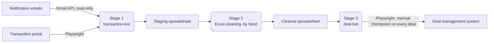

# Transaction Data Automation

At the real estate brokerage where I worked as a transaction accounting intern, every new transaction was recorded by hand. Someone read the notification email, looked the transaction up in an external transaction portal, copied the address, dates, price and every agent's commission into both a spreadsheet and the company's deal management system.

I automated that workflow in three stages. It eliminated about an average of 20 hours of manual data entry a month. I built it in about 40 hours of my own time over one month, using various AI coding assistants to write and debug code, while I designed the workflow, the business rules and the checks.

> Shared with permission from my former employer. All company data, system addresses, email details and page structure have been removed, and the examples use invented data. The tool has since been replaced by another automation. 

This repository is a showcase of a tool that ran in production, not a working install. System addresses, email details and login data have been removed, so it won't run end to end. The deal-bot's data-loading step still runs on the sample data (see [Try it](#try-it-with-sample-data)).

## How it works



### Stage 1: transaction-bot (`transaction_bot/`)

1. Reads transaction notification emails for a chosen date range through the Gmail API and pulls out the MLS and contract numbers.
2. Builds a worklist in email order. The same transaction can trigger several emails, so duplicates are removed by key: the MLS number, or the contract number when there's no MLS.
3. Searches the portal for each transaction, opens it, and scrapes the address, dates, types, sold price and every agent on the file with their office, title and commission.
4. Appends one row per agent per transaction to a staging spreadsheet.

Design choices:
- **Gmail API instead of scraping the Gmail website.** The API is stable and lets the bot read mail without being able to change it.
- **Page elements located by ID, not by visible text.** The portal switches between English and French, so text-based matching broke.
- **Dates read from hidden form fields**, which hold a clean `YYYY-MM-DD` value, with the visible labels as a fallback.
- **No filtering in code.** The bot keeps every agent on the file, and filtering to our brokerage happens in stage 2, where the rules are easy to see and change.

### Stage 2: Excel cleaning (by hand)

I cleaned the staging sheet in Excel without code: filtering to our brokerage's agents, looking up each agent's office, standardizing titles, converting text to numbers, separating the postal code and calculating each agent's share of the commission. The steps are written up in [`docs/excel_cleaning.md`](docs/excel_cleaning.md). I then copy pasted this cleaned data into a new excel sheet for the next step

### Stage 3: deal-bot (`deal_bot/`)

1. Reads the cleaned sheet and groups rows by MLS number into deals, each with seller-side and buyer-side advisors.
2. For each deal, fills in the deal form: office, dates, price, advisors with their commission shares, and commission amounts.
3. Records each completed deal so it's never entered twice.

## Safeguards

Because stage 3 writes into the company's records, most of the checks are there.

- **Manual checkpoint on every deal.** Before each deal is completed, the script stops and waits for me to enter the MLS number in the form and press ENTER. The browser always stays visible, so I watched each deal being filled in. I checked to make sure the right advisors were selected, correct commission prices were entered (so they didn't add or miss a decimal) as well as date, price, etc. I added a human style delay in the data entry in the playwright code so I could monitor closely. 
- **Commission shares must total 100%.** Any deal whose shares don't add up is skipped and reported, not entered.
- **Commission amounts come straight from the data.** Nothing is estimated or calculated from the sale price.
- **No guessing on ambiguous matches.** If a portal search returns more than one transaction, the bot reports it and moves on. If an office or advisor name can't be matched exactly in the deal system, that deal fails with a clear error instead of the bot picking the closest option.
- **No duplicate deals.** Completed MLS numbers are saved to a progress file, so rerunning the deal-bot skips deals already entered.
- **Failures stop for a decision.** On any error the deal-bot takes a screenshot and asks whether to continue, retry or stop.
- **The staging sheet is checked before writing.** The writer confirms every expected column header exists and refuses to write otherwise, so rows can't land in the wrong columns.
- **Limited access.** Gmail was connected through OAuth with read-only access. The OAuth files and all settings stayed on the machine that ran the bots and are not in this repository. Logins to both systems were done by hand in the browser, so the scripts never handled passwords.

## Problems I ran into

- **Two numbers merged into one.** The commission cell shows the dollar amount with the percentage on the line below. Reading the whole cell produced a single invalid number combining both. I changed the scraper to extract only the first dollar amount.
- **The bot clicked the wrong tab.** The portal's top navigation and the open transaction both had an "agents" tab with similar names, and the bot matched the wrong one. Scoping the click to the transaction's own tab strip, by ID, fixed it.
- **An AI suggestion I rejected.** When I asked the AI assistant to improve the deal-bot, one version estimated a missing commission as a percentage of the sale price. Commissions are recorded amounts, so I had it use the Rétribution column only. Writing an estimate into the company's records would have created figures nobody could trace.
- **Naming conventions.** Because the names of agents, street names and license names were sometimes entered in French and sometimes in English a lot of street names, agent names and more deviated a lot, I mostly had to clean these in excel. 

## How it evolved

Neither bot was built in one pass. The portal scraper went through about ten versions as I worked through the problems above: the portal switching between English and French, clicks landing on the wrong tab, and the commission cell merging two numbers. The deal-bot went through three main versions, plus eight debugging copies that I ran against a test spreadsheet before it touched real deals. The progress file that prevents double entry and the screenshot on every failure were both added in the final version. This repository contains only the final version of each script.

## Limitations and what I'd change

- **Placeholder values.** If a deal has no postal code, the deal-bot enters a placeholder (`H0H 0H0`). Square footage is always entered as 1. Both of these were things I had to do manually because of how data was historically entered in the systems. 
- **Stage 1 doesn't remember past runs.** Running it twice over the same dates appends the same rows again. I'd add a progress file like the deal-bot's.
- **The contract-number search** was never confirmed against the portal, because nearly every transaction had an MLS number.
- **Page changes break it.** Like any browser automation, the bots depend on the systems' page layout. Unfortunately the portal we used got updated slightly every few years.
- **Checks were manual.** I verified output by comparing it against the portal and running `check_portal_search.py` on single transactions. I'd now add automated tests for the parsing functions (money, dates, deduplication).

## About this published version

To publish it, I made these changes:

- removed every system address and email detail, leaving a marked placeholder in the config files
- replaced the real page selectors with invented examples of the same format
- removed the saved browser session the original stage 1 kept between runs, so the browser now starts fresh each time
- rewrote comments, removed one duplicated function and replaced every example with invented data

I no longer have access to the systems, so this version hasn't been re-run against them. Apart from those edits, the logic is the version that ran in production.

## Repository layout

```
transaction_bot/
  pipeline_gmail_to_excel.py   Stage 1 entry point
  portal_scraper.py            Portal search and scraping
  excel_writer.py              Appends rows under the expected headers
  worklist.py, models.py       Extracting IDs and removing duplicates
  portal_browser.py            Opens the browser for manual login
  config.py                    Loads config.json
  config.example.json          Placeholder settings
  check_portal_search.py       Manual check on one transaction
deal_bot/
  main_production.py           Stage 3 entry point
  .env.example                 Placeholder settings
  office_map.example.json      Placeholder office names
docs/
  excel_cleaning.md            Stage 2 steps
sample_data/
  staging_template.xlsx        Empty stage 1 output sheet
  cleaned_sample.xlsx          Invented stage 3 input
```

## Running it (for reference)

The real addresses and credentials are removed, so these steps show how the bots were run rather than something you can run today.

**Stage 1** (Python 3.14):

```
cd transaction_bot
python -m venv .venv
.venv\Scripts\activate
pip install -r requirements.txt
playwright install chromium
```

Copy `config.example.json` to `config.json` and fill in the real values. Put Google OAuth desktop credentials in `credentials.json`, and copy `sample_data/staging_template.xlsx` to the workbook path in the config. Then run, for example:

```
python pipeline_gmail_to_excel.py --start-date 2026-01-15 --end-date 2026-01-16
```

The end date is exclusive, so this processes January 15 only.

**Stage 3:** in `deal_bot/`, install `requirements.txt` the same way, copy `.env.example` to `.env` and `office_map.example.json` to `office_map.json`, fill in real values, then run `python main_production.py`.

### Try it with sample data

The deal-bot's loading and validation step runs without the deal system:

```
cd deal_bot
copy .env.example .env
copy office_map.example.json office_map.json
python -c "import main_production as m; m.load_deals()"
```

It reads the invented deals from `sample_data/cleaned_sample.xlsx`, checks each one's commission shares and reports how many are ready to enter.

## Built with

Python, Playwright, Gmail API, openpyxl, pandas and Excel, with ChatGPT, Claude and Gemini as a coding assistant.
